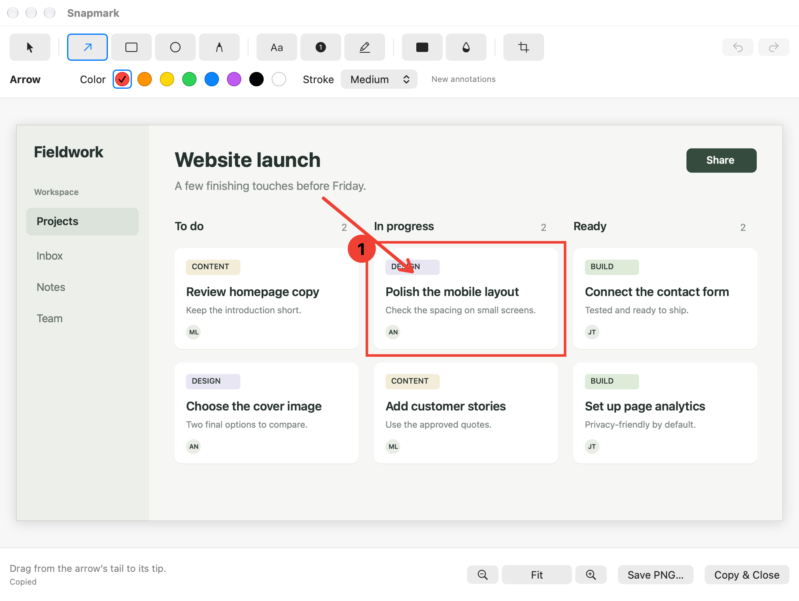

<p align="center">
  
</p>
<h1 align="center">Snapmark</h1>
<p align="center"><strong>Capture, annotate, and paste from your Mac menu bar.</strong></p>
<p align="center">
  <strong><a href="https://github.com/zackbraksa/snapmark/releases/download/v0.1.0/Snapmark-0.1.0-macOS.zip">Download Snapmark for macOS</a></strong><br>
  macOS 14 or later · Apple silicon and Intel
</p>

Unzip the download and move **Snapmark.app** to **Applications**. Allow Screen Recording when macOS asks on your first capture.



Grab an area, a window, or the whole screen. Mark up what matters with arrows, shapes, text, and numbered steps. Copy the result straight into a message or save it as a PNG.

Snapmark works locally. It keeps the current screenshot in memory and updates your clipboard as you edit. Use solid redaction to cover sensitive pixels in the exported image.

## Build from source

You’ll need macOS 14 or later and Xcode 16 or later.

```sh
git clone https://github.com/zackbraksa/snapmark.git
cd snapmark
./script/build.sh
open dist/Snapmark.app
```

The script builds a separate development app in `dist/`. An ad hoc-signed development build may need Screen Recording permission again after a rebuild.

If you have a signing identity in your Keychain, set `SNAPMARK_SIGNING_IDENTITY` when building to keep the app’s signing identity stable.

## Default shortcuts

| Action | Shortcut |
| --- | --- |
| Capture an area | <kbd>⌃</kbd> <kbd>⌥</kbd> <kbd>⌘</kbd> <kbd>A</kbd> |
| Capture a window | <kbd>⌃</kbd> <kbd>⌥</kbd> <kbd>⌘</kbd> <kbd>W</kbd> |
| Capture the full screen | <kbd>⌃</kbd> <kbd>⌥</kbd> <kbd>⌘</kbd> <kbd>S</kbd> |
| Copy and close the editor | <kbd>⌃</kbd> <kbd>⌥</kbd> <kbd>⌘</kbd> <kbd>C</kbd> |

Change any shortcut in Snapmark Settings.

## Tests

```sh
swift test --build-system native
```

## License

[MIT](LICENSE)
